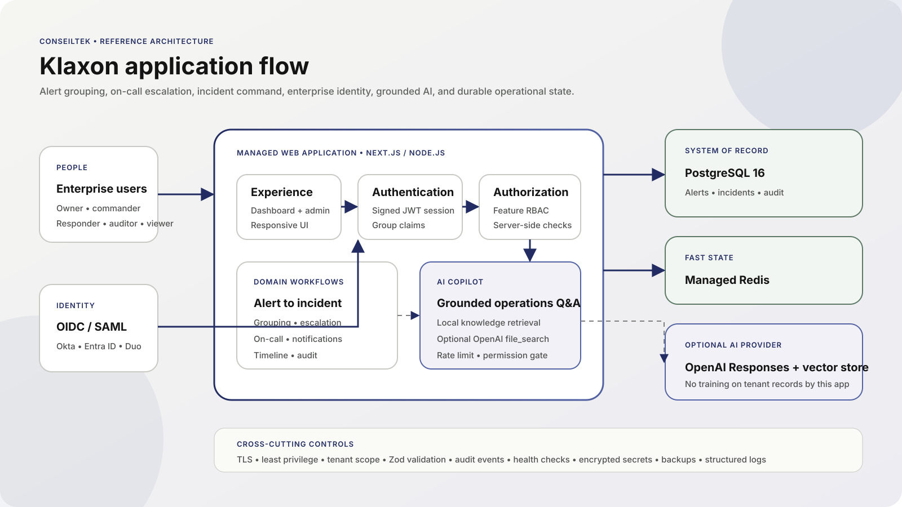
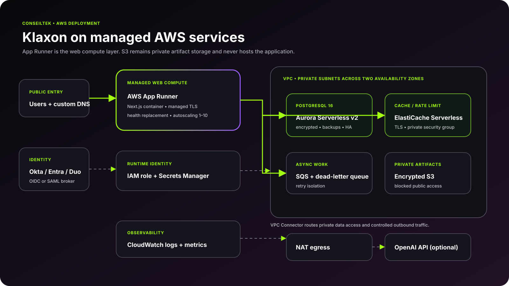
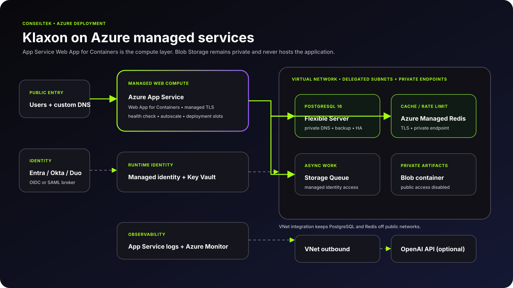

<div align="center">
  
  <h1>Klaxon</h1>
  <p><strong>On-call that pages people, not your budget.</strong></p>
  <p>Alert grouping · escalation · incident command · enterprise SSO · configurable RBAC · PostgreSQL · grounded AI</p>
</div>

[](https://github.com/ConseilTek-Tektons/klaxon/actions/workflows/ci.yml) [](https://github.com/ConseilTek-Tektons/klaxon/actions/workflows/codeql.yml) [](LICENSE)

Klaxon gives reliability teams an accountable path from noisy telemetry to a human response: normalize and group alerts, resolve the effective on-call person, escalate through versioned policy, and coordinate an incident on an append-only timeline. This repository contains the working application and the deployment package—not a UI mockup.



## Working capabilities

- Services, rotations, overrides, escalation policies, alerts, incidents, timelines, notifications, maintenance windows, and audit records
- Deterministic alert fingerprints, idempotent delivery records, and permission-checked incident declaration API
- Configurable roles for owners, administrators, incident commanders, responders, observers, auditors, and viewers
- OIDC for Okta or Microsoft Entra ID; SAML providers including Duo connect through Keycloak or another OIDC broker
- Response copilot grounded in approved incident operations and runbooks, with citations and no acknowledge/resolve tools
- ConseilTek-branded responsive command view, working declare-incident interaction, policy editor, and health endpoint
- Docker Compose plus AWS Terraform and Azure Bicep deployment paths

## Run locally

```bash
cp .env.example .env
docker compose up --build
```

Open [http://localhost:3000](http://localhost:3000); Keycloak runs on port 8080. For manual development use `pnpm install`, `pnpm db:migrate`, `pnpm db:seed`, and `pnpm dev`.

## Managed cloud deployment

Klaxon requires server-side authentication, transactions, notification orchestration, and health replacement. Do not deploy it as a static web application.

| Cloud | Managed web runtime | PostgreSQL | Cache | Deployment |
|---|---|---|---|---|
| AWS | AWS App Runner | Aurora PostgreSQL Serverless v2 | ElastiCache Serverless | [Terraform](infra/aws/README.md) |
| Azure | Azure App Service Web App for Containers | PostgreSQL Flexible Server | Azure Managed Redis | [Bicep](infra/azure/README.md) |

Managed runtimes, databases, and caches reduce host, orchestrator, backup, patching, and scaling maintenance. The included queues separate delivery work; operators can attach their approved SMS, voice, email, and chat providers.





## Operate and extend

- [Architecture](docs/ARCHITECTURE.md) · [Authentication](docs/AUTHENTICATION.md) · [RBAC](docs/RBAC.md)
- [AI and RAG](docs/AI.md) · [Security](docs/SECURITY.md) · [Operations](docs/OPERATIONS.md)
- Quality gate: `pnpm check`, Terraform validation, Bicep compilation, and an OCI container build

## Ownership

Klaxon is designed, built, and maintained by [ConseilTek](https://conseiltek.com) and licensed under Apache 2.0. ConseilTek trademarks and supplied brand artwork are not granted by the source-code license. Contact [support@conseiltek.com](mailto:support@conseiltek.com).
