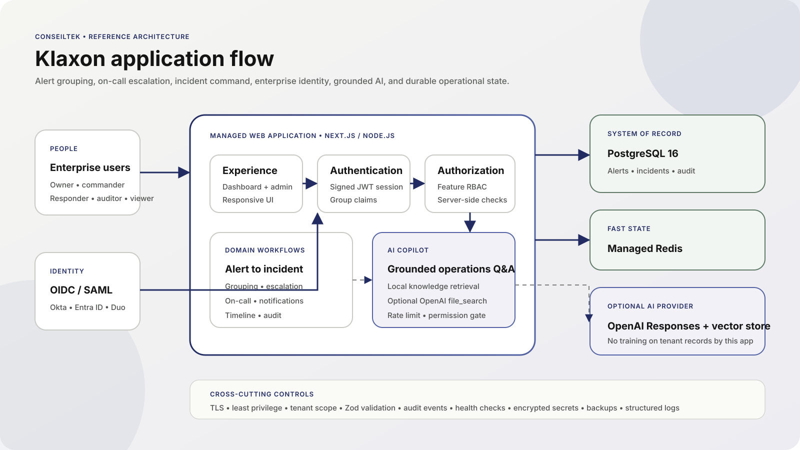

# Klaxon architecture

Klaxon separates a stateless web control plane from durable operational state and asynchronous delivery. The reference keeps one portable Next.js container, PostgreSQL as the source of truth, Redis for rate limits, and managed queue/object services for provider adapters and incident artifacts.

## Request and event flow

1. App Runner or App Service accepts HTTPS for the UI, alert webhooks, and identity callbacks.
2. Alert adapters normalize source payloads, compute a stable fingerprint, and upsert an active group inside the configured time window.
3. Versioned escalation policy resolves the effective on-call identity at delivery time, including exact schedule overrides.
4. Notification work is queued and provider attempts are recorded idempotently as queued, sent, delivered, or failed.
5. Declaring an incident creates its accountable record, initial timeline entry, and audit event in one PostgreSQL transaction.
6. The response copilot reads approved runbooks and permitted incident context. It cannot acknowledge alerts, page responders, or change incident state.

## Bounded modules

| Module | Owns |
|---|---|
| Alert intake | normalization, deduplication fingerprints, occurrence counts, maintenance suppression |
| On-call | schedules, rotations, overrides, escalation steps |
| Incident command | severity, commander, lifecycle, alert links, append-only timeline |
| Delivery | channel adapters, idempotency, retries, provider receipts |
| Governance | enterprise identity, feature RBAC, audit, health and observability |

## Reliability invariants

- Raw occurrences are never lost when alerts group; first/last seen and count remain queryable.
- Retries reuse an idempotency identity and never create a second incident implicitly.
- Schedule overrides do not rewrite the base rotation.
- The timeline is append-only at the application boundary and separates observation from inference.

The templates are a single-region reference control plane. Multi-region active/active notification delivery requires provider-specific routing and replicated operational design. App Runner and App Service remain the supported web runtimes; static hosting cannot run this workload.
